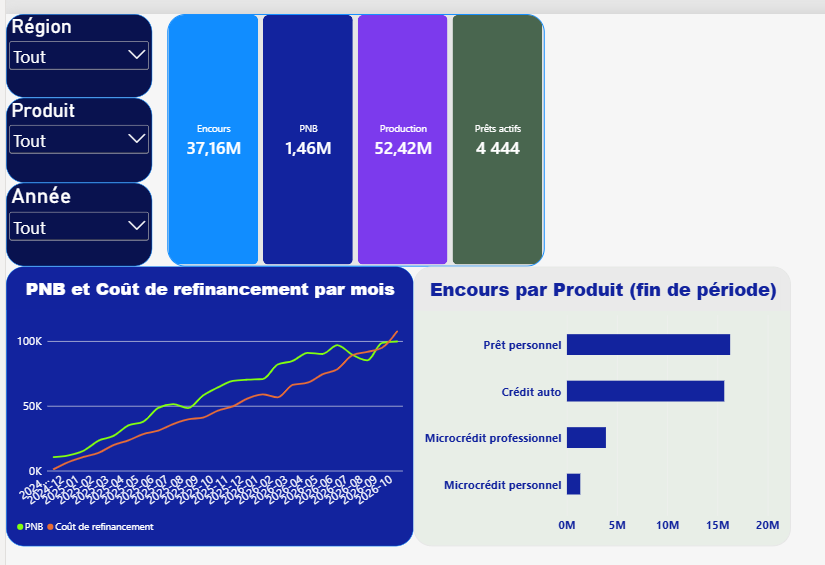
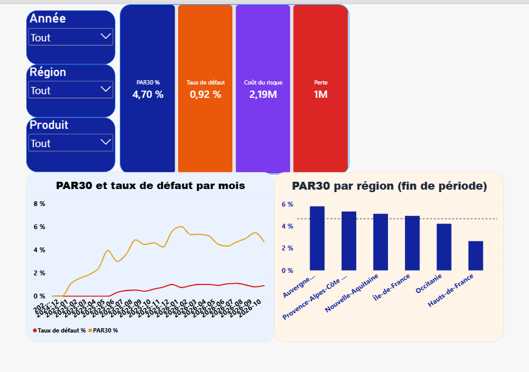
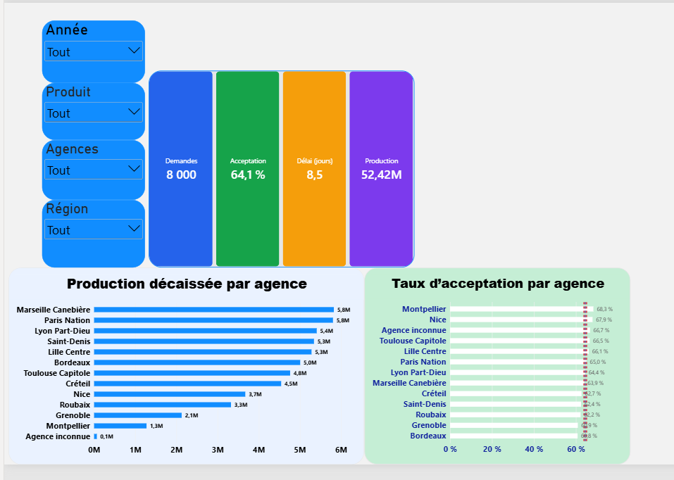
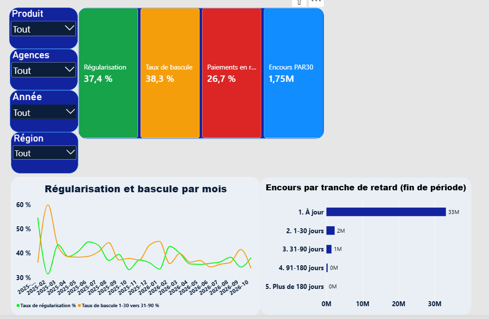

# Atelia Crédit — Enterprise Data Platform & BI

[](https://github.com/enamainnocent4-crypto/atelia-credit-data-platform/actions/workflows/ci.yml)

Mini-plateforme décisionnelle de bout en bout pour un établissement fictif de microcrédit et de crédit à la consommation en France : des systèmes sources jusqu'aux indicateurs de pilotage dans Power BI.



## Ce que démontre ce projet

- **Une chaîne complète, de la source au KPI** : trois sources (fichiers CSV, API interne, API publique de la BCE), ingestion Python incrémentale et idempotente, entrepôt PostgreSQL, modèle en étoile construit avec dbt, rapport Power BI de quatre pages.
- **Une qualité mesurée, pas supposée** : 170 anomalies injectées volontairement dans les sources, **170 détectées** par les tests dbt. 73 tests dbt et des tests pytest, rejoués à chaque push par GitHub Actions.
- **Des chiffres qui se contrôlent entre eux** : les indicateurs clés de Power BI (encours, PAR30, défaut, PNB, production, régularisation) sont comparés mois par mois à leur calcul SQL, avec un écart **nul**. Trois tests de réconciliation vérifient qu'aucune ligne ne se perd et qu'aucun montant ne diffère d'une table à l'autre.
- **Un écart de 218 750 € expliqué, corrigé et verrouillé** : une différence de production entre deux pages du rapport a été prouvée par une requête SQL, corrigée dans la règle de gestion, puis protégée par un test automatique (voir [Décisions et problèmes résolus](#décisions-et-problèmes-résolus)).
- **Un vocabulaire métier bancaire** : encours, PNB, PAR30, défaut, provisions, coût du risque, taux de régularisation et de bascule.

## Objectif

Démontrer la conception d'un système d'information décisionnel complet : ingestion de sources hétérogènes, modélisation en étoile, transformations testées, restitution métier et industrialisation.

## Cas métier

Atelia Crédit pilote son activité avec quatre décideurs :

| Décideur | Question | Indicateurs |
| --- | --- | --- |
| Direction générale | Gagne-t-on de l'argent, et grâce à quoi ? | PNB, production |
| Direction des risques | Nos clients remboursent-ils ? | PAR30, taux de défaut, coût du risque |
| Direction du réseau | Nos agences produisent-elles bien et vite ? | Taux d'acceptation, délai d'instruction |
| Service recouvrement | Qui appeler en priorité, et nos actions marchent-elles ? | Taux de régularisation, taux de bascule |

Toutes les données sont synthétiques : aucune donnée personnelle réelle n'est utilisée (RGPD).

## Architecture

```
Sources (CSV, API interne FastAPI, API BCE)
        │
        ▼
Ingestion Python ──► PostgreSQL : raw ──► staging ──► marts (modèle en étoile)
                                     dbt (modèles, tests, snapshots)
        │
        ▼
Power BI (tableau de bord de pilotage)
```

Schémas détaillés, rôle de chaque couche et décisions techniques : [docs/architecture.md](docs/architecture.md).

| Dossier | Rôle |
| --- | --- |
| `data_generator/` | Génération des données synthétiques |
| `api/` | API interne simulant le système bancaire central |
| `ingestion/` | Chargement des sources dans la couche `raw` |
| `dbt/` | Transformations `staging` et `marts`, tests de qualité |
| `tests/` | Tests automatisés (pytest) |
| `powerbi/` | Rapport Power BI, thème, mesures DAX et relations |
| `docs/` | [Documentation d'architecture](docs/architecture.md) et captures du rapport |
| `sql/init/` | Initialisation de la base (schémas) |

## Démarrage rapide

Prérequis : Docker Desktop lancé, Python 3.12.

```bash
cp .env.example .env                  # puis changer les secrets dans .env
py -3.12 -m venv .venv
.\.venv\Scripts\Activate.ps1          # Windows PowerShell
pip install -r requirements.txt
python -m data_generator.generate     # 1. génère les données sources
docker compose up -d --build          # 2. démarre PostgreSQL et l'API
docker compose ps                     # les deux services doivent être "healthy"
python -m ingestion.run               # 3. charge les sources dans la couche raw
python run_dbt.py build               # 4. construit staging, intermediate, marts et lance les tests
```

| Service | Adresse | Accès |
| --- | --- | --- |
| PostgreSQL | `localhost:55432`, base `atelia_dw` | utilisateur `atelia`, mot de passe du `.env` |
| API core banking | `http://localhost:8100/docs` | en-tête `X-API-Key` (clé du `.env`) |

Les ports 55432 et 8100 évitent les conflits avec un PostgreSQL ou une autre API déjà présents sur le poste. Ils se changent dans `.env` (`POSTGRES_PORT`, `API_PORT`).

## Données synthétiques

Le générateur simule 24 mois d'activité (novembre 2024 à octobre 2026) dans l'ordre chronologique : client → demande → décision → décaissement → échéancier → paiements. Une graine fixe rend les données reproductibles à l'identique.

| Dossier de sortie (`data/generated/`) | Fichiers | Rôle |
| --- | --- | --- |
| `reference/` | `branches.csv`, `products.csv` | Référentiels (12 agences, 4 produits) |
| `crm/` | `customers.csv` | Export CRM (~5 200 clients fictifs) |
| `core_banking/` | `applications.csv`, `loans.csv`, `installments.csv`, `payments.csv` | Système bancaire central, servi par l'API |
| `_ground_truth/` | `customer_profiles.csv`, `injected_anomalies.csv` | Vérité cachée, pour valider les tests de qualité |

Profils de clients : 65 % de bons payeurs, 25 % de retards qui se régularisent, 10 % de ruptures de paiement. Environ 170 anomalies sont injectées volontairement (doublons, montants négatifs, agence inconnue, paiement antérieur au décaissement) : les tests dbt doivent toutes les détecter.

## Sources

| Source | Type | Contenu |
| --- | --- | --- |
| `data/generated/reference/` | Fichiers CSV | Référentiels agences et produits |
| `data/generated/crm/` | Fichier CSV | Export CRM des clients |
| API core banking (`api/`) | API REST interne (FastAPI) | Demandes, prêts, échéances, paiements |
| [ECB Data Portal](https://data.ecb.europa.eu/) (`ingestion/ecb_client.py`) | API REST publique | Taux €STR quotidien, pour le coût de refinancement |

L'API core banking propose :

- `GET /applications`, `/loans`, `/installments`, `/payments` : listes paginées (`limit`, `offset`), triées par date de mise à jour ;
- le paramètre `updated_since` pour le chargement incrémental ;
- `GET /health` pour la supervision (sans authentification) ;
- une documentation interactive générée automatiquement sur `/docs`.

## Ingestion

```bash
python -m ingestion.run                  # chargement normal (incrémental)
python -m ingestion.run --full-refresh   # tout recharger depuis zéro
python -m ingestion.run --only api       # une seule famille : csv, api ou ecb
```

| Source | Table `raw` | Mode |
| --- | --- | --- |
| `reference/branches.csv`, `reference/products.csv`, `crm/customers.csv` | `branches`, `products`, `customers` | Rechargement complet |
| API core banking | `applications`, `loans`, `installments`, `payments` | Incrémental (`updated_since`) |
| API BCE | `ecb_estr_rates` | Incrémental (depuis la dernière date chargée) |

Principes :

- **Fidélité** : `raw` stocke les données telles que reçues (colonnes texte), anomalies comprises, avec trois colonnes techniques (`_loaded_at`, `_source`, `_batch_id`). Le typage et le nettoyage se font dans dbt.
- **Idempotence** : chaque source est chargée dans une transaction, avec son marque-page. Une relance ne crée aucun doublon ; un échec n'écrit rien.
- **Traçabilité** : chaque exécution est journalisée dans `raw._ingestion_log` et `logs/ingestion.log` ; les marque-pages sont dans `raw._ingestion_state`.

## Transformations (dbt)

```bash
python run_dbt.py debug              # vérifier la connexion
python run_dbt.py build              # construire les modèles et lancer les tests
python run_dbt.py source freshness   # vérifier la fraîcheur des sources
```

`run_dbt.py` charge les identifiants du `.env` puis lance dbt : aucun secret n'est écrit dans `dbt/profiles.yml`.

**Staging** (`dbt/models/staging/`, schéma `staging`, en vues) : un modèle par table `raw`, nommé `stg_<source>__<table>`. On y type les colonnes, on les renomme, sans supprimer aucune ligne : le grain reste celui de la source.

**Tests de qualité** : 73 tests dbt sur l'ensemble du projet (unicité, non-nullité, intégrité référentielle, valeurs acceptées, montants positifs, cohérence des dates, réconciliations). Les quatre tests qui visent les anomalies connues de la source sont en mode avertissement et enregistrent les lignes fautives dans le schéma `audit` :

| Test | Anomalie détectée | Lignes |
| --- | --- | --- |
| `payments_payment_id_is_unique` | Paiement en double | 120 |
| `applications_requested_amount_is_positive` | Montant demandé négatif | 20 |
| `applications_branch_code_exists_in_referential` | Agence inconnue | 15 |
| `payments_not_before_disbursement` | Paiement antérieur au décaissement | 15 |

Total : **170 anomalies détectées pour 170 injectées** par le générateur (`_ground_truth/injected_anomalies.csv`).

## Modèle en étoile (marts)

| Table | Type | Grain |
| --- | --- | --- |
| `dim_date` | Dimension | Un jour (2024 à 2027) |
| `dim_branch` | Dimension | Une agence, plus le membre « Agence inconnue » |
| `dim_product` | Dimension | Un produit de crédit |
| `dim_customer` | Dimension historisée (SCD 2) | Une version de client |
| `fact_credit_application` | Faits, photo cumulative | Une demande de crédit (dépôt → décision → versement) |
| `fact_payment` | Faits, transactionnelle | Un paiement reçu |
| `fact_loan_balance_monthly` | Faits, photo périodique | Un prêt à une fin de mois |
| `kpi_portfolio_monthly` | Agrégat de contrôle | Un mois (référence pour valider les mesures Power BI) |

**Indicateurs de risque et de rentabilité** (`fact_loan_balance_monthly`) : encours, jours de retard et tranche de retard, PAR30, défaut (plus de 90 jours), provisions, passages en perte (plus de 180 jours), coût du risque, intérêts, frais de dossier, coût de refinancement et PNB.

Hypothèses simplifiées, paramétrées dans `dbt/dbt_project.yml` (`vars`) :

| Hypothèse | Valeur |
| --- | --- |
| Coût de refinancement | €STR moyen du mois + 1 point, sur l'encours moyen, base exact/360 |
| Provisions par tranche de retard (logique inspirée d'IFRS 9) | 1 % à jour, 5 % de 1 à 30 jours, 25 % de 31 à 90 jours, 100 % au-delà |
| Passage en perte | Plus de 180 jours de retard |
| Coût du risque | Variation des provisions + passages en perte |

**Traitement des anomalies** (couche `intermediate`), chacune tracée avec sa raison dans `audit.quarantined_records` :

| Anomalie | Traitement | Pourquoi |
| --- | --- | --- |
| Paiement en double | Dédoublonné : le premier exemplaire est conservé | Un paiement ne doit être compté qu'une fois |
| Paiement antérieur au décaissement | Écarté des faits | Impossible dans la réalité : la ligne n'est pas fiable |
| Montant demandé négatif | Montant mis à vide, demande **conservée et signalée** (`is_requested_amount_valid = 0`) | L'erreur porte sur une saisie, pas sur le prêt : certaines de ces demandes ont réellement été décaissées |
| Agence inconnue | Rattachée au membre « Agence inconnue » | Aucun fait n'est perdu, l'anomalie reste visible dans le rapport |

Trois tests de réconciliation vérifient la cohérence d'ensemble : chaque demande reçue se retrouve dans `fact_credit_application` ; chaque paiement reçu se retrouve soit dans `fact_payment`, soit en quarantaine ; la production décaissée est identique dans `fact_credit_application` et dans `fact_loan_balance_monthly`.

**Historisation des clients** : un snapshot dbt (`snapshots/snap_customers.sql`) conserve chaque version d'un client quand sa ville, son revenu, son segment ou son e-mail change. Pour la démontrer :

```bash
python -m data_generator.crm_update      # 3 % des clients déménagent, 5 % changent de revenu
python -m ingestion.run --only csv       # recharge l'export CRM
python run_dbt.py build                  # le snapshot ajoute les nouvelles versions
```

## Rapport Power BI

Le rapport (`powerbi/atelia_credit.pbix`) lit les tables `marts` de PostgreSQL en mode Import. Il répond aux quatre décideurs du cas métier, avec une page chacun. Les captures montrent les chiffres à la date d'arrêté du 31 octobre 2026 (données synthétiques).

| Page | Décideur | Indicateurs clés |
| --- | --- | --- |
| Direction générale | Direction générale | Encours 37,16 M€, PNB 1,46 M€, production 52,42 M€, 4 444 prêts actifs |
| Risques | Direction des risques | PAR30 4,70 %, taux de défaut 0,92 %, coût du risque 2,19 M€, passages en perte environ 1 M€ |
| Réseau d'agences | Direction du réseau | 8 000 demandes, taux d'acceptation 64,1 %, délai d'instruction 8,5 jours |
| Recouvrement | Service recouvrement | Taux de régularisation 37,4 %, taux de bascule 38,3 %, encours PAR30 1,75 M€ |

**Modèle** : 13 relations un-à-plusieurs à sens unique entre les dimensions et les faits, créées par script (`powerbi/relations.tmdl`). La relation entre `dim_date` et la date de décaissement des demandes est **inactive** : la mesure « Production décaissée » l'active avec `USERELATIONSHIP`, pour compter les demandes à leur date de dépôt et la production à sa date de versement.

**Mesures** : 25 mesures DAX (`powerbi/mesures_et_validation.dax`). L'encours, le PAR30 et les provisions sont **semi-additifs** : ils s'additionnent entre agences ou produits, jamais entre mois. Sur une période, les mesures prennent donc la photo du dernier mois.

**Validation** : le même fichier contient une requête qui compare, mois par mois, six indicateurs clés (encours, PAR30, taux de défaut, PNB, production, taux de régularisation) à leur calcul SQL de référence (`kpi_portfolio_monthly`). Tous les écarts sont nuls.

| Risques | Réseau d'agences | Recouvrement |
| --- | --- | --- |
|  |  |  |

## Décisions et problèmes résolus

**Un écart de 218 750 € entre deux pages.** La production affichait 52,42 M€ en page Direction générale et 52,20 M€ en page Réseau d'agences. Une requête SQL a montré que l'écart venait de 16 prêts réellement décaissés, dont la demande avait été exclue à cause d'un montant demandé négatif. Décision : une erreur de saisie se **signale**, elle n'efface pas une opération réelle. Les demandes sont désormais conservées avec un indicateur, et un test dbt (`reconciliation_production`) échoue si la production diffère un jour entre les deux tables de faits.

**L'encours ne s'additionne pas dans le temps.** Additionner l'encours de douze fins de mois donnerait un montant qui n'a jamais existé. Les mesures d'encours, de PAR30 et de provisions prennent la photo de la dernière fin de mois de la période sélectionnée, ce qui est précisé dans les titres des visuels (« fin de période »).

**Un service externe ne doit pas casser la chaîne.** L'API de la BCE renvoie parfois une réponse vide, quand le taux du jour n'est pas encore publié : l'ingestion la traite comme « aucune nouvelle cotation » au lieu d'échouer. En intégration continue, la BCE est remplacée par un taux fixe, pour qu'un test n'échoue que si le code du projet est cassé.

**Aucune donnée ne disparaît sans trace.** Les lignes douteuses ne sont jamais supprimées en silence : elles sont dédoublonnées, écartées ou signalées, et toujours enregistrées dans le schéma `audit` avec leur raison. Le rapport montre même l'« Agence inconnue » pour que l'anomalie reste visible des décideurs.

## Tests et intégration continue

```bash
pip install -r requirements-dev.txt
ruff check .                      # style et erreurs courantes du code Python
pytest -m "not integration"       # tests unitaires : générateur, API, client BCE (sans base)
pytest -m integration             # tests d'intégration : base remplie par le pipeline et dbt
```

À chaque push, GitHub Actions (`.github/workflows/ci.yml`) :

1. vérifie le code avec ruff et lance les tests unitaires ;
2. crée un PostgreSQL temporaire, génère les données, démarre l'API, lance l'ingestion, puis `dbt build` ;
3. lance les tests d'intégration, dont la mesure d'efficacité des tests de qualité : **chaque anomalie injectée doit être détectée par dbt**.

En CI, l'API de la BCE est remplacée par un taux fixe (`tests/fixtures/ci_seed_ecb_rates.sql`) : un test ne doit échouer que si le code du projet est cassé, pas parce qu'un service externe est indisponible.

## Stack

Python 3.12 (pandas, NumPy, Faker, psycopg) · PostgreSQL 16 · dbt 1.11 · FastAPI · Power BI (DAX, TMDL) · Docker Compose · pytest · ruff · GitHub Actions

## Avancement

- [x] Étape 0 — Cadrage métier
- [x] Étape 1 — Environnement
- [x] Étape 2 — Données synthétiques
- [x] Étape 3 — Sources
- [x] Étape 4 — Ingestion
- [x] Étape 5 — dbt staging
- [x] Étape 6 — Modèle en étoile
- [x] Étape 7 — Qualité et intégration continue
- [x] Étape 8 — Power BI
- [ ] Étape 9 — Documentation (README, architecture, etc.)

## Contact

ENAMA Innocent — [profil LinkedIn](https://www.linkedin.com/in/enama-innocent-501880327) · [GitHub](https://github.com/enamainnocent4-crypto)
