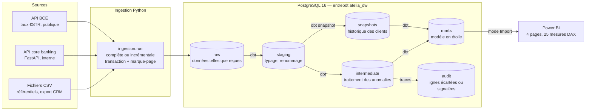
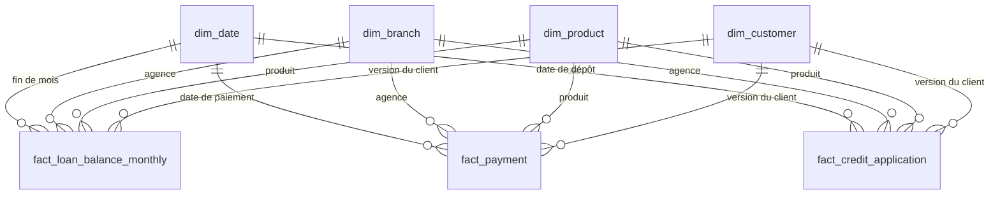

# Architecture — Atelia Crédit

Ce document explique **comment** la plateforme est organisée et **pourquoi** elle l'est ainsi. Pour l'installation et les commandes, voir le [README](../README.md).

## 1. Vue d'ensemble

L'ensemble tourne en local avec **Docker Compose** (PostgreSQL et l'API). À chaque push, **GitHub Actions** rejoue toute la chaîne sur une base temporaire : génération des données, ingestion, `dbt build`, puis tests d'intégration.

## 2. Les couches de données

| Schéma | Rôle | Règle principale | Matérialisation |
| --- | --- | --- | --- |
| `raw` | Copie fidèle des sources | Tout est stocké en texte, tel que reçu, anomalies comprises, avec la date, la source et le lot de chargement | Tables, remplies par l'ingestion Python |
| `staging` | Nettoyage technique | Un modèle par table source. On type et on renomme, on ne supprime **aucune** ligne | Vues |
| `intermediate` | Règles de gestion sur les anomalies | Dédoublonner, écarter ou signaler, et toujours tracer la raison | Vues, sauf deux calculs lourds en tables |
| `snapshots` | Historique des clients | Chaque changement de ville, de revenu, de segment ou d'e-mail crée une nouvelle version | Table gérée par dbt |
| `marts` | Modèle en étoile lu par Power BI | Des grains clairs, des clés de substitution, un membre « inconnu » | Tables |
| `audit` | Contrôle qualité | Les lignes fautives de chaque test, et la table des lignes écartées ou signalées | Tables |

**Pourquoi autant de couches ?** Chaque couche a une seule responsabilité. Si un chiffre est faux dans Power BI, on remonte couche par couche jusqu'à la source, et `raw` permet toujours de retrouver la donnée d'origine.

## 3. Le modèle en étoile

| Table de faits | Type | Grain | Exemples de mesures |
| --- | --- | --- | --- |
| `fact_credit_application` | Photo cumulative | Une demande, suivie du dépôt à la décision puis au versement | Demandes, taux d'acceptation, délai d'instruction, production décaissée |
| `fact_payment` | Transactionnelle | Un paiement reçu | Paiements reçus, part des paiements en retard |
| `fact_loan_balance_monthly` | Photo périodique | Un prêt à une fin de mois | Encours, PAR30, défaut, provisions, coût du risque, PNB |

`fact_credit_application` a aussi une relation avec `dim_date` par sa **date de décaissement**. Cette relation est **inactive** dans Power BI : la mesure « Production décaissée » l'active avec `USERELATIONSHIP`.

## 4. Les décisions techniques

### dbt plutôt que des scripts SQL lancés à la main
- **Alternatives écartées** : des fichiers `.sql` exécutés dans l'ordre par un script, ou des procédures stockées.
- **Raison** : dbt calcule seul l'ordre d'exécution à partir des dépendances (`ref`), versionne les transformations avec Git, et apporte les tests de qualité, la documentation et l'historisation (snapshots) dans le même outil.

### Ingestion incrémentale avec marque-pages
- **Alternative écartée** : tout recharger à chaque passage.
- **Raison** : seules les lignes modifiées depuis le dernier passage sont demandées à l'API (`updated_since`). Le marque-page vient de la **source** (la date `updated_at`), pas de l'horloge du PC. Il est enregistré dans la **même transaction** que les données : en cas d'échec, rien n'est écrit et la relance reprend exactement au même point, sans doublon. Les petits fichiers de référence, eux, sont rechargés en entier : c'est plus simple et sans coût.

### Garder `raw` fidèle, nettoyer dans dbt
- **Alternative écartée** : nettoyer pendant l'ingestion.
- **Raison** : une anomalie corrigée à l'entrée disparaît sans laisser de trace. En la gardant dans `raw` et en la traitant dans dbt, on peut la **mesurer** : 170 anomalies injectées, 170 détectées.

### Signaler plutôt qu'exclure
- **Alternative écartée** : supprimer toute ligne qui contient une erreur.
- **Raison** : une erreur de saisie sur une demande (un montant demandé négatif) ne rend pas faux le prêt qui a réellement été versé. L'exclure faisait disparaître 218 750 € de production. La demande est conservée avec un indicateur, et un test vérifie que la production est identique dans les deux tables de faits.

### Historisation des clients par snapshot (SCD de type 2)
- **Alternative écartée** : écraser la fiche client à chaque mise à jour (type 1).
- **Raison** : un client qui déménage ne doit pas déplacer son historique. Chaque fait est relié à la version du client **valide à sa date**, ce qui garde juste une analyse par ville ou par tranche de revenu dans le temps.

### Power BI en mode Import plutôt que DirectQuery
- **Alternative écartée** : interroger PostgreSQL à chaque clic (DirectQuery).
- **Raison** : le volume est modeste et les mesures (encours semi-additif, `USERELATIONSHIP`) sont plus rapides et plus simples en Import. Le rapport s'ouvre même quand la base est arrêtée. La contrepartie : il faut actualiser le rapport après chaque `dbt build`.

### Des données synthétiques
- **Alternative écartée** : un jeu de données public réel.
- **Raison** : aucune donnée personnelle (RGPD), un contexte bancaire français maîtrisé, et surtout une **vérité cachée** (`_ground_truth/`) : on connaît chaque anomalie injectée et le profil de chaque client, ce qui permet de prouver que les tests fonctionnent.

### Un service externe remplacé en intégration continue
- **Alternative écartée** : appeler la vraie API de la BCE dans la CI.
- **Raison** : un test ne doit échouer que si le code du projet est cassé, pas parce qu'un service externe est lent ou indisponible. En CI, la BCE est remplacée par un taux fixe (`tests/fixtures/ci_seed_ecb_rates.sql`).

## 5. Limites et évolutions

Ce projet est une démonstration sur un poste de travail. En entreprise, voici ce qu'il faudrait ajouter, et comment.

| Limite actuelle | Évolution possible |
| --- | --- |
| L'ingestion et dbt se lancent à la main, dans l'ordre | Un **orchestrateur** (Airflow ou Dagster) qui enchaîne ingestion, `dbt build` et actualisation de Power BI, avec reprises et alertes |
| Les tables `marts` sont reconstruites en entier à chaque passage | Des **modèles dbt incrémentaux** pour les grosses tables de faits, quand le volume augmente |
| Tout le monde voit toutes les agences dans le rapport | La **sécurité au niveau des lignes** (RLS) dans Power BI : chaque directeur d'agence ne voit que la sienne |
| Le rapport s'actualise à la main dans Power BI Desktop | Une publication sur le **service Power BI**, avec une actualisation planifiée via une passerelle |
| La plateforme tourne en local avec Docker | Un hébergement **cloud** (base PostgreSQL managée, conteneurs) et des secrets gérés par un coffre-fort |
| Les règles de risque sont simplifiées (taux de provision fixes par tranche) | Un modèle de provisionnement **IFRS 9** complet (probabilité de défaut, perte en cas de défaut, scénarios économiques) |
